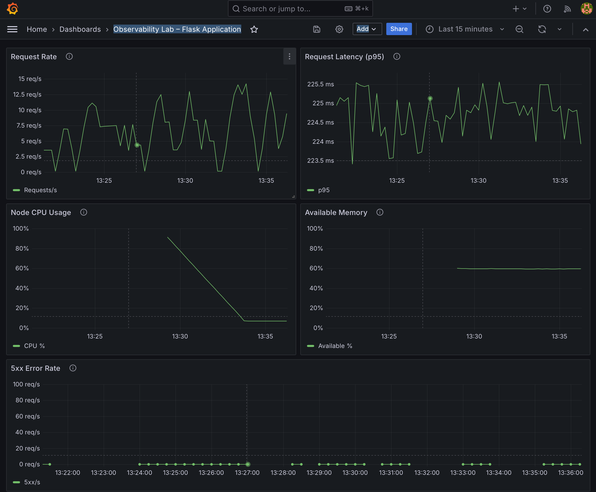
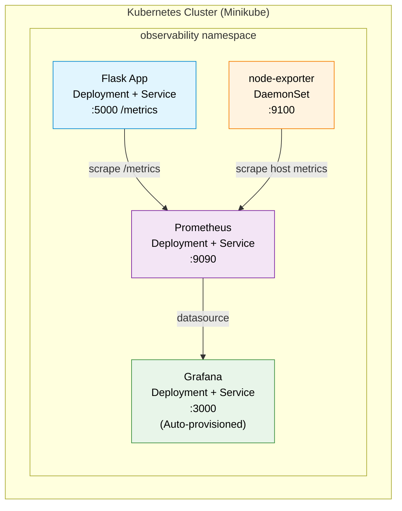

# Observability Lab – Flask + Prometheus + Grafana on Kubernetes

Complete observability stack for a simple Python (Flask) application running on Kubernetes (Minikube). The application exposes custom metrics that are scraped by Prometheus together with `node-exporter`. Grafana is automatically provisioned with a datasource and a professional dashboard.

---

## Dashboard Preview



> **Dashboard:** `Observability Lab – Flask Application Dashboard` *(auto-provisioned via ConfigMap)*

---

## Architecture



---

## Features

- **Flask Application:** Instrumented with custom metrics (request rate, latency histogram, and HTTP status codes).
- **Prometheus:** Scrapes both application metrics and host metrics via `node-exporter`.
- **Grafana:** Automatic provisioning via ConfigMaps (datasource + pre-built dashboard).
- **Pure Kubernetes Manifests:** Everything defined declaratively without Helm.

### Dashboard Panels

- Request Rate
- Latency (`p95`)
- Node CPU Usage
- Available Memory
- `5xx` Error Rate

---

## Prerequisites

- [Minikube](https://minikube.sigs.k8s.io/docs/)
- [Docker](https://docs.docker.com/)
- [kubectl](https://kubernetes.io/docs/tasks/tools/)

---

## Project Structure

```text
observability-lab/
├── app/
│   ├── app.py
│   ├── Dockerfile
│   └── requirements.txt
├── k8s/
│   ├── 00-namespace.yaml
│   ├── 01-flask-deployment.yaml
│   ├── 02-flask-service.yaml
│   ├── 03-node-exporter.yaml
│   ├── 03b-node-exporter-service.yaml
│   ├── 04-prometheus-config.yaml
│   ├── 05-prometheus-deployment.yaml
│   ├── 06-prometheus-service.yaml
│   ├── 07-grafana-deployment.yaml
│   ├── 08-grafana-service.yaml
│   ├── 09-grafana-datasources.yaml
│   ├── 10-grafana-dashboards-provider.yaml
│   └── 11-grafana-dashboard.yaml
├── screenshot.jpeg
└── README.md
```

---

## Quick Start

```bash
# 1. Start Minikube
minikube start --cpus=2 --memory=4096

# 2. Build the Flask image inside Minikube
eval $(minikube docker-env)
cd app
docker build -t flask-observability:latest .
cd ..

# 3. Deploy everything
kubectl apply -f k8s/

# 4. Wait for pods to be ready
kubectl get pods -n observability -w
```

### Generate Traffic *(Optional, Recommended)*

```bash
kubectl port-forward -n observability svc/flask-app 5000:5000 &

for i in {1..200}; do
  curl -s http://localhost:5000/ > /dev/null
  curl -s http://localhost:5000/slow > /dev/null
  curl -s http://localhost:5000/error > /dev/null
done
```

---

## Accessing the Services

### Grafana

```bash
minikube service grafana -n observability
```

| Parameter | Value |
| :--- | :--- |
| **URL** | Shown by the command above |
| **User** | `admin` |
| **Password** | `admin123` |

> The dashboard **"Observability Lab – Flask Application Dashboard"** is automatically loaded on startup.

### Prometheus

```bash
kubectl port-forward -n observability svc/prometheus 9090:9090
```

Then open [http://localhost:9090](http://localhost:9090) in your browser.

---

## Cleanup

```bash
kubectl delete -f k8s/
minikube stop   # or: minikube delete
```

---

## Notes

- The Flask image is built locally and loaded directly into Minikube's Docker daemon (`imagePullPolicy: IfNotPresent`).
- Grafana provisioning is handled declaratively via ConfigMaps (datasource + dashboard JSON).
- `node-exporter` runs as a `DaemonSet` with host mounts to collect real node-level metrics.
- Designed as a portfolio project demonstrating Kubernetes orchestration, observability stacks, and custom metric instrumentation.